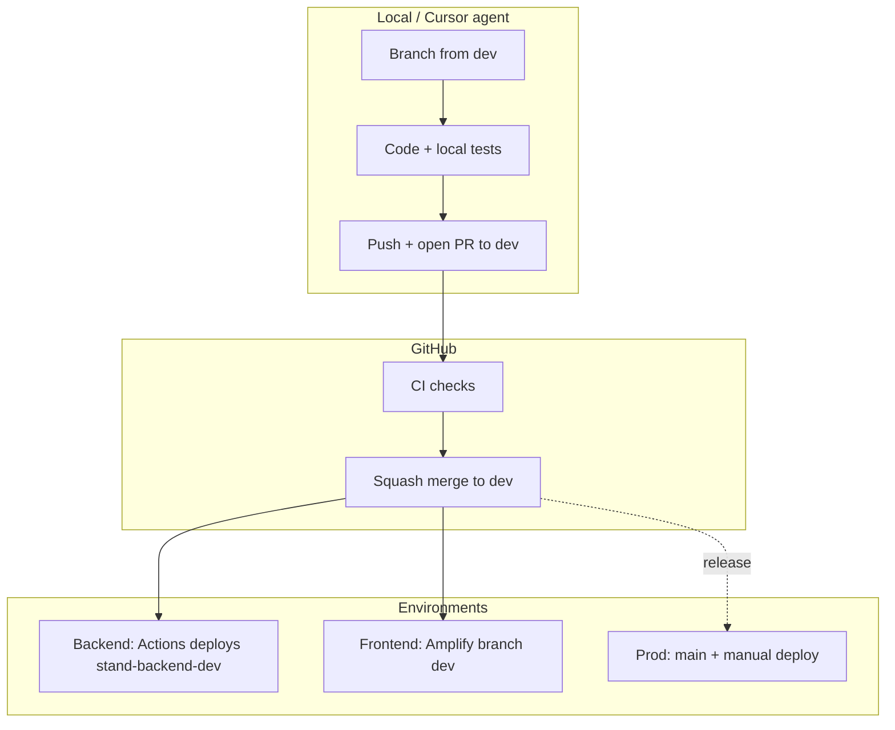

# Development workflow and CI/CD

How to develop Stand across the three repos, what GitHub Actions does, and how AI agents (Cursor) should fit in.

Related: [DEV_ENVIRONMENT.md](DEV_ENVIRONMENT.md) (AWS setup), [stand-frontend new-game-playbook](https://github.com/adrisanpu/stand-frontend/blob/dev/docs/new-game-playbook.md) (new games).

## Repos and branches

| Repo | Default branch | Integration branch | Prod deploy |
|------|----------------|--------------------|-------------|
| stand-backend | `main` | `dev` | Manual `sam deploy --config-env prod` |
| stand-frontend | `main` | `dev` | Amplify (`playstand.app`) |
| stand-website | `main` | — (work on `main` or add `dev` later) | Amplify on `main` |

All three repos: **squash merge only** (GitHub Free — repo-level setting). Re-apply with [`scripts/apply-squash-merge-settings.ps1`](../scripts/apply-squash-merge-settings.ps1) if needed.

## End-to-end flow



### 1. Feature branch

```bash
git checkout dev && git pull
git checkout -b feature/my-change
```

| Repo | Verify locally before PR |
|------|--------------------------|
| stand-backend | `pytest tests/`, `sam build` |
| stand-frontend | `npm run build` (and `npm run dev` for UI) |
| stand-website | `npm run build` |

### 2. Pull request to `dev`

Open a PR **into `dev`** (backend and frontend). CI runs automatically:

| Repo | Workflow | PR job |
|------|----------|--------|
| stand-backend | `.github/workflows/ci.yml` | `test` — pytest |
| stand-frontend | `.github/workflows/ci.yml` | `build` — `tsc` + Vite |
| stand-website | `.github/workflows/ci.yml` | `build` — Vite |

Fix failures, then **squash merge** (only option enabled).

### 3. After merge to `dev`

| What | How |
|------|-----|
| Backend API (dev) | Push to `dev` triggers `deploy-dev`: `sam build` + `sam deploy --config-env dev` |
| Frontend UI (dev) | Amplify app connected to branch `dev` → `dev.playstand.app` |
| Data | DynamoDB `stand-dev-*`, dev API Gateway host, URL path `/prod` |

No manual `sam deploy --config-env dev` needed after merge unless debugging CI.

### 4. Production

1. PR **`dev` → `main`** (squash merge).
2. **Backend:** local `sam deploy --config-env prod` (`confirm_changeset = true` in `samconfig.toml`).
3. **Frontend / website:** Amplify deploy from `main`.

CI **never** deploys prod.

## Cross-repo changes

For a new game or API contract:

1. Backend first (routes, Lambdas, `type.<GAME_TYPE>` blob).
2. Frontend second (`src/games/<id>/`, `gameTypeMap`, register in `index.ts`).
3. Use matching IDs: frontend lowercase `id`, backend uppercase `GAME_TYPE`.

## AI agents (Cursor)

### Agents should

- Read the sub-project `CLAUDE.md` before editing that repo.
- Branch from `dev` (or `main` for stand-website until a `dev` branch exists).
- Run local checks (`pytest`, `npm run build`) before suggesting a PR is ready.
- Open PRs to `dev` and wait for green CI before merge.
- Keep PRs focused; avoid unrelated drive-by changes.
- For cross-repo work, state order: backend → frontend → manual verification on dev.

### Agents should not

- Deploy to **prod** (`sam deploy --config-env prod`) unless the user explicitly asks.
- Assume `sam deploy` to dev after merge — CI does that on push to `dev`.
- Mix game `id` / `GAME_TYPE` casing.
- Commit secrets (`.env`, keys).

### Typical agent loop

1. Implement on a feature branch.
2. Run local tests/build.
3. Commit and push; create or update PR to `dev`.
4. If CI fails, read Actions logs, fix, push again.
5. Tell the user when checks are green and squash merge is safe.
6. Remind user to verify `dev.playstand.app` (or local `.env.development`) after backend/frontend land.

## One-time infrastructure (already done if CI is green)

- OIDC stack: [`infra/github-actions-oidc.yaml`](../infra/github-actions-oidc.yaml) → [`scripts/setup-github-oidc.ps1`](../scripts/setup-github-oidc.ps1)
- GitHub secret `AWS_ROLE_ARN_DEV` on `adrisanpu/stand-backend`
- Squash-only merge: [`scripts/apply-squash-merge-settings.ps1`](../scripts/apply-squash-merge-settings.ps1)

Details: [DEV_ENVIRONMENT.md § CI/CD](DEV_ENVIRONMENT.md#cicd).
